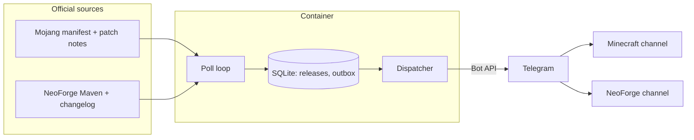

# Minecraft & NeoForge Telegram Release Monitor

A small, self-hosted service that watches the **official** sources for new Minecraft Java Edition
and NeoForge releases and posts an announcement for each one to **two independent Telegram
channels**: one for Minecraft, one for NeoForge.

- Runs as a hardened, non-root Docker container (the compose files cap it at 128 MB of RAM).
- State lives in a single SQLite file, so restarts, reboots and outages do not lose announcements.
- Python 3.14, two small runtime dependencies (`httpx`, `tzdata`), fully typed, tested with mocked APIs.

> **Project status.** The code, container and automation are implemented and tested locally.
> The GitHub workflows have been linted but have **not run on GitHub yet**, and the container image
> has **not been published to GHCR yet**. Until the first release exists, build the image yourself
> (see [Quick start](#quick-start-docker-compose-build-locally)).

## Contents

[Features](#features) · [How it works](#how-it-works) · [Requirements](#requirements) ·
[Telegram setup](#telegram-setup) · [Configuration](#configuration) ·
[Quick start](#quick-start-docker-compose-build-locally) · [Production (GHCR)](#production-deployment-with-ghcr) ·
[Raspberry Pi, NAS, Linux](#raspberry-pi-5-nas-and-linux-servers) · [Operations](#operations) ·
[Backfill](#backfill-old-releases) · [Migrating](#migrating-an-existing-deployment) ·
[Automation](#automatic-updates) · [Security](#security) · [Limitations](#limitations) ·
[Troubleshooting](#troubleshooting) · [Contributing](#contributing) · [License](#license)

## Features

- **Minecraft Java Edition**: stable releases by default; optionally snapshots and pre-releases / release
  candidates (two independent switches). Version, type and the official release time come from Mojang's
  [version manifest](https://piston-meta.mojang.com/mc/game/version_manifest_v2.json). Highlights come from
  Mojang's official patch-notes feed, and an article link is included only after it was confirmed to exist.
- **NeoForge**: every build from major version 26 upwards (future majors are picked up automatically), stable
  and optionally beta/alpha builds, read from the official
  [Maven metadata](https://maven.neoforged.net/releases/net/neoforged/neoforge/maven-metadata.xml). The
  changelog of *that build only* is extracted from the official changelog file (never the whole history).
  The Maven metadata is **not** in chronological order, so versions are sorted explicitly.
- **Honest timestamps**: every date line says what it is: `Released` (official), `Artifact timestamp`
  (when the build file was uploaded) or `Detected` (when this monitor first saw it).
- **Reliable delivery**: an outbox with retries, exponential backoff, `retry_after` handling for HTTP 429,
  tag-safe message splitting, and crash recovery. See [Limitations](#limitations) for what no software can promise.
- **No flood on first start**: existing versions are recorded silently. Changing a filter later
  (for example enabling snapshots) never announces old versions either.
- **Operations**: graceful `SIGTERM` shutdown, a health check that needs no network, structured logs with
  secret redaction, single-instance lock, automatic schema migration, consistent backups.

## How it works



Every poll (default 5 minutes) the monitor reads both sources. New versions that pass your filters are
queued in the outbox with a ready-made message and delivered one at a time. If the official notes or
changelog are not published yet, the release waits up to `CHANGELOG_GRACE_MINUTES` (default 30) and is then
announced with a clear "not available yet" note plus the official link. Details:
[docs/architecture.md](docs/architecture.md).

### Example announcements

> **Illustrative data only.** These were rendered by the real formatter from invented versions
> (`99.x`) and an example link. The actual messages use the same layout with real data.

Minecraft:

```text
⛏️ Minecraft Java Edition Update

Version: 99.1
Type: Stable
📅 Released: 15 Jan 2026, 11:23 UTC

📋 Changelog
• Added an example biome
• Changed an example crafting recipe
• Fixed an example crash

🔗 Official release notes
```

NeoForge:

```text
🛠️ NeoForge Update

Version: 99.1.0.5-beta
Minecraft compatibility: 99.1
Release status: Beta
📅 Artifact timestamp: 15 Jan 2026, 11:40 UTC

📋 Changelog
• Example change to the loader (#0000)

🔗 Official changelog
```

When the changelog is late and no file timestamp is available:

```text
🛠️ NeoForge Update

Version: 99.1.0.6-beta
Minecraft compatibility: unverified
Release status: Beta
📅 Detected: 15 Jan 2026, 12:00 UTC

📋 Changelog
⏳ The official changelog is not available yet; see the link below.

🔗 Official changelog
```

"Minecraft compatibility" is shown only when the Minecraft version derived from the NeoForge version number
(`26.1.0.5-beta` is for `26.1`, as documented by [NeoForged](https://docs.neoforged.net/docs/gettingstarted/versioning/))
exists in Mojang's manifest; otherwise it says `unverified`. Times are shown in `DISPLAY_TIMEZONE` (UTC by default).

## Requirements

- Docker with Compose v2 (Linux, Raspberry Pi OS, a NAS with Docker, or Docker Desktop on Windows/macOS).
- A Telegram bot token and two channels where the bot is an administrator.
- Outbound HTTPS to `piston-meta.mojang.com`, `launchercontent.mojang.com`, `www.minecraft.net`,
  `maven.neoforged.net` and `api.telegram.org`.
- To develop without Docker: Python 3.14 and [uv](https://docs.astral.sh/uv/).

## Telegram setup

Short version (full walkthrough in [docs/telegram-setup.md](docs/telegram-setup.md)):

1. Talk to [@BotFather](https://t.me/BotFather), send `/newbot`, and keep the token it gives you secret.
2. Create **two channels** (public ones get an `@name`, private ones a numeric id like `-1001234567890`).
3. In each channel: *Administrators → Add administrator → your bot*, and allow **Post Messages**.
4. Put the token and both channel ids into your `.env` (next section), then run the connectivity test.

## Configuration

Configuration is read from environment variables. Copy the template and edit it on the machine that
runs the service:

```sh
cp .env.example .env     # the canonical template is .env.example
chmod 600 .env           # Linux/macOS/Pi/NAS. Not applicable on Windows (use normal file permissions)
```

> **Note.** The maintainer creates `.env.example` separately; until it is committed, `docs/env.example`
> contains exactly the same placeholders (`cp docs/env.example .env` works too).

| Variable | Default | Meaning |
|---|---|---|
| `TELEGRAM_BOT_TOKEN` | required | Bot token from BotFather. Never commit it. |
| `TELEGRAM_BOT_TOKEN_FILE` | unset | Path to a file holding the token (for example a Docker secret). Used only when `TELEGRAM_BOT_TOKEN` is unset. |
| `MINECRAFT_CHANNEL_ID` | required | `@public_channel` or a numeric chat id such as `-1001234567890`. |
| `NEOFORGE_CHANNEL_ID` | required | Same format. |
| `MINECRAFT_SNAPSHOTS` | `false` | Also announce snapshots. |
| `MINECRAFT_PRERELEASES` | `false` | Also announce pre-releases and release candidates. |
| `NEOFORGE_BETAS` | `true` | Announce beta and alpha builds; `false` means stable builds only. |
| `NEOFORGE_MIN_MAJOR` | `26` | Ignore NeoForge builds with a lower major version. |
| `POLL_SECONDS` | `300` | Poll interval; the minimum is 60. |
| `CHANGELOG_GRACE_MINUTES` | `30` | How long to wait for official notes/changelog before announcing without them. `0` = never wait. |
| `AMBIGUOUS_POLICY` | `retry` | What to do when a send may or may not have been delivered: `retry` (possible duplicate) or `skip` (possible miss). See [Limitations](#limitations). |
| `DISPLAY_TIMEZONE` | `UTC` | IANA zone used in messages, for example `Europe/Madrid`. |
| `LOG_LEVEL` | `INFO` | `DEBUG`, `INFO`, `WARNING`, `ERROR` or `CRITICAL`. |
| `LOG_FORMAT` | `text` | `text` or `json`. Timestamps are always UTC. |
| `DB_PATH` | `/data/releases.sqlite3` | SQLite file (the container image sets this; keep it on a volume). |
| `HTTP_TIMEOUT_SECONDS` | `25` | Timeout for every outgoing HTTP request. |

Booleans accept `true/yes/1/on` and `false/no/0/off`. All problems in a configuration are reported at once
and the service exits with code 2 without printing any secret.

### Why `.env` must never be committed

`.env` holds your bot token. Anyone with the token controls your bot and can post to your channels. Git
history is permanent and public repositories are scanned by bots within minutes, so a pushed token must be
treated as compromised. This project defends the file in five layers (details in
[docs/security.md](docs/security.md)):

1. `.gitignore` ignores `.env`, `.env.*` (except `.env.example`), keys, certificates and database files.
2. `.dockerignore` keeps them out of the Docker build context, so they can never reach an image layer.
3. `scripts/git-safety-check.sh` and the pre-commit hooks block secret-bearing files locally.
4. CI re-checks the full history with gitleaks and scans the built image.
5. GitHub push protection and secret scanning (enable them on the repository) work server-side.

Layers 1 to 3 run on your machine and can be bypassed (for example `git commit --no-verify`); layers 4 and 5
are the ones you cannot bypass by accident.

## Quick start (Docker Compose, build locally)

```sh
git clone https://github.com/athegreat90/minecraft-neoforge-telegram-monitor.git
cd minecraft-neoforge-telegram-monitor
cp .env.example .env && chmod 600 .env       # then edit the three required values
docker compose run --rm release-monitor test-telegram
docker compose up -d --build
docker compose logs -f release-monitor
```

`test-telegram` checks the token and posts one clearly labelled test message to each channel without
touching any state. Use `test-telegram --no-send` to check the token only.

The first regular poll **records all existing versions silently**. Nothing is posted until a genuinely new
release appears.

## Production deployment with GHCR

`compose.prod.yaml` runs a published image, so no local build is needed. Copy only that file and your `.env`:

```sh
docker compose -f compose.prod.yaml run --rm release-monitor test-telegram
docker compose -f compose.prod.yaml up -d
```

The image is `ghcr.io/athegreat90/minecraft-neoforge-telegram-monitor`. `IMAGE_TAG` selects the tag:

| Tag | Meaning |
|---|---|
| `1` (default) | Latest 1.x release |
| `1.2` / `1.2.3` | Latest patch of 1.2 / exactly 1.2.3 |
| `latest` | Latest stable release |
| `sha-<commit>` | One exact commit (immutable by convention) |
| `edge` | Latest `main`, for testing |

For reproducible servers pin an exact version, for example `IMAGE_TAG=1.2.3`. Rolling back is setting the
previous tag and running `docker compose -f compose.prod.yaml up -d`.

> The first image will exist only after a release is published (see [docs/automation.md](docs/automation.md)),
> and the package must be switched to **public** once in the GitHub package settings. Until then the
> default tag `1` does not exist yet.

## Raspberry Pi 5, NAS and Linux servers

The image targets `linux/amd64` and `linux/arm64`, so the same compose file works on a Raspberry Pi 5
(64-bit Raspberry Pi OS or Ubuntu), x86 mini PCs, Ubuntu/Debian servers and NAS systems with Docker. An
arm64 build of the Dockerfile was run locally under emulation; the multi-arch CI build has not run yet.

- Install Docker Engine and the Compose plugin ([official instructions](https://docs.docker.com/engine/install/)).
- The default setup uses a **named volume** (`releases-data`), which needs no permission work.
- If you prefer a **bind mount** (common on NAS), the directory must be writable by uid/gid 10001:
  `sudo chown 10001:10001 /path/to/data`.
- **Do not put the SQLite file on NFS or SMB shares.** File locking is unreliable there. Use local disk.
- The container is limited to 128 MB of RAM and 64 processes; that is plenty for this workload.

More in [docs/deployment.md](docs/deployment.md).

## Operations

```sh
docker compose logs --tail=100 release-monitor     # inspect logs
docker compose ps                                  # shows (healthy) / (unhealthy)
docker compose restart release-monitor             # restart
docker compose up -d --force-recreate              # apply .env changes
docker compose -f compose.prod.yaml pull && docker compose -f compose.prod.yaml up -d   # upgrade
```

Other commands (all via `docker compose run --rm release-monitor <command>`):

| Command | Purpose |
|---|---|
| `run` | Poll forever (the container default). |
| `once` | One poll cycle, then exit (needs the instance lock: stop the service first). Exit code 1 if a source failed. |
| `test-telegram [--no-send]` | Verify the token and post a labelled test message. |
| `healthcheck` | Exit 0 when healthy, 1 otherwise. Used by Docker; never touches the network. |
| `backfill --source … [--since V] [--limit N] [--yes]` | List or post past releases. See below. |
| `rebaseline --source … [--yes]` | Record all current versions as known without posting. |
| `db-backup [--dest PATH]` | Write a consistent copy of the database. |
| `version` | Print the version. |

Exit codes: `0` success, `1` runtime failure or unhealthy, `2` invalid configuration or usage, `3` another
instance is using the database, `4` database problem. The legacy flags `--once` and `--test` still work.

### SQLite persistence and backup

State is in `/data/releases.sqlite3` inside the `releases-data` volume. It survives container recreation,
image upgrades and host reboots. Back it up with the built-in command; it uses SQLite's `VACUUM INTO`, so
the copy is consistent while the service runs:

```sh
docker compose exec release-monitor python -m release_monitor db-backup
```

The copy lands next to the database as `releases.sqlite3.<UTC timestamp>.bak` inside the volume, so copy
it out of the volume to keep it safe. An integrity check runs at every start. A damaged database makes the
service exit with code 4 and an explanation; it is **never deleted automatically**. To recover, restore a
backup, or (if you accept losing history) start with a fresh volume, or keep the file and run
`rebaseline --source minecraft --yes` and `rebaseline --source neoforge --yes` so the next start does not
re-announce anything.

## Backfill old releases

Backfill is deliberately a **command, not an environment variable**, so it can never run by accident. It
lists first and posts only with `--yes`. It (like `once` and `rebaseline`) takes the single-instance lock, so
stop the running service first (`docker compose stop release-monitor`) or the command exits with code 3;
start it again afterwards.

```sh
docker compose run --rm release-monitor backfill --source neoforge --limit 3          # dry run: lists
docker compose run --rm release-monitor backfill --source neoforge --limit 3 --yes    # posts, oldest first
```

The window is the newest `--limit` releases (default 10) that pass your current filters, optionally not
older than `--since <version>`. Versions that already have a notification are skipped, so repeating a command
never posts anything twice.

## Migrating an existing deployment

If you ran the earlier single-file `monitor.py` version:

- Keep using the same compose project directory name: the named volume `releases-data` is reused.
- On first start the old database is **copied to `releases.sqlite3.bak-v1`** and migrated to schema v2 in one
  transaction. Nothing already announced is announced again. The old `sent` table is left in place, but it is
  not updated afterwards: after a rollback to the old image, anything announced since the migration could be
  announced again, so restore `releases.sqlite3.bak-v1` as well if you roll back.
- Environment variable names are unchanged. New optional ones are in the table above. The fixed
  `Europe/Madrid` display zone is gone: set `DISPLAY_TIMEZONE=Europe/Madrid` to keep it.
- `docker compose run --rm release-monitor --test` still works as an alias of `test-telegram`.

## Automatic updates

- **Dependencies, Docker base images and GitHub Actions** are updated by [Renovate](https://docs.renovatebot.com/)
  (the only updater; Dependabot version updates are intentionally off).
- **Python** itself is tracked in `.python-version` and the Dockerfile. Patch releases get a pull request that
  merges automatically once all required checks pass (after a 3-day wait). A **new feature release**
  (for example 3.14 to 3.15) opens a pull request labelled `python-feature-upgrade` that always needs your manual
  review. Pre-releases are never proposed, and a version is only proposed once its official Docker image
  exists. As of 2026-10-12 Python 3.15.0 was released but `python:3.15-slim` was not published yet.
- **Releases** are driven by conventional commits through release-please; merging its release pull request
  tags the version and publishes the image.

Everything about this, including the required setup steps (installing the Renovate app, repository rules),
is in [docs/automation.md](docs/automation.md).

## Security

- Never commit, paste or share `.env` or the token. Use `chmod 600 .env`.
- Prefer a Docker secret with `TELEGRAM_BOT_TOKEN_FILE` so the token does not show up in `docker inspect`.
- Logs redact the token. If you share logs, still read them first.
- The container is non-root (uid 10001), read-only, drops all capabilities and sets `no-new-privileges`;
  the image contains no build tools.
- If a token ever leaks: send `/revoke` to BotFather, put the new token in `.env`, recreate the container.

See [docs/security.md](docs/security.md) and [SECURITY.md](SECURITY.md).

## Limitations

- **Exactly-once delivery is impossible.** Telegram offers no idempotency key and bots cannot read channel
  history. If Telegram accepts a message but the response is lost (timeout, crash), the monitor cannot know.
  By default it **retries** (`AMBIGUOUS_POLICY=retry`), which can produce a rare duplicate; `skip` instead
  risks a rare missed announcement. Clear failures (HTTP 429, 5xx, connection refused) are retried safely.
- **Three different times.** *Official release time* exists for Minecraft only. For NeoForge the Maven server
  provides only a *file upload time*, labelled `Artifact timestamp`. If even that is missing the message says
  `Detected` (when this monitor saw it). The three are never mixed up.
- **Notes can be late.** Official notes or changelogs sometimes appear after the version. The monitor waits
  up to `CHANGELOG_GRACE_MINUTES` and then announces without them, with the official link. The message is not
  edited afterwards.
- Highlights are a short, non-exhaustive summary taken from the official text; the link is the source of truth.
- Only Minecraft **Java Edition** is monitored, not Bedrock.
- Notifications are delayed by up to one poll interval plus the publishing delay at the source.

## Troubleshooting

| Symptom | Likely cause and fix |
|---|---|
| `Telegram check failed: … 400 … chat not found` | Wrong channel id, or the bot is not in that channel. Public channels need `@name`; private ones need the numeric `-100…` id. |
| `… 403 … forbidden` / not enough rights | The bot is not an administrator with **Post Messages**. Add it to the channel's administrators. |
| `… 401 …` | Wrong or revoked token. Check `TELEGRAM_BOT_TOKEN`; create a new one with BotFather `/revoke` if needed. |
| HTTP 429 in the logs | Telegram rate limit. The monitor waits the `retry_after` Telegram asks for and retries; no action needed. |
| Container is `unhealthy` | `docker compose exec release-monitor python -m release_monitor healthcheck` prints the reason: no heartbeat yet (starting), a stale heartbeat (loop stuck), or no successful poll for 6 intervals (network or source outage). |
| Exit code 2, "Invalid configuration" | Read the listed problems; every one is reported at once. |
| Exit code 3, another instance is using the database | A second container or process uses the same data directory. Stop it; only one monitor may use a database. |
| Exit code 4, database error | Corruption or a newer schema than this version. See [SQLite persistence and backup](#sqlite-persistence-and-backup). |
| Nothing was posted after the first start | Expected: the first poll only records existing versions. Use `test-telegram` to verify the channels. |
| I think my token leaked | `/revoke` with BotFather immediately, update `.env`, recreate the container, review [docs/security.md](docs/security.md). |

## Contributing

Contributions are welcome. Start with [CONTRIBUTING.md](CONTRIBUTING.md): setup with uv, the checks to run,
conventional commits, and the one hard rule, never commit `.env`.

## License

[MIT](LICENSE) © 2026 athegreat90
