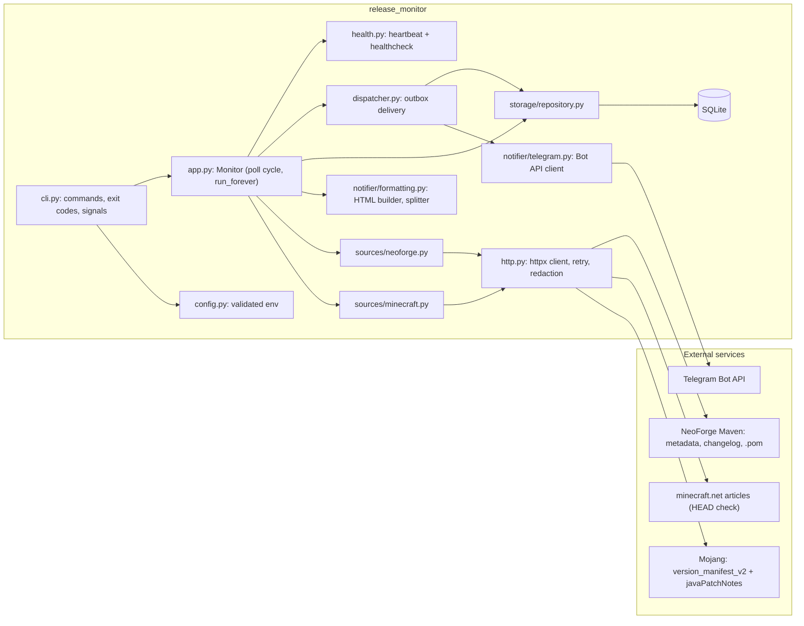
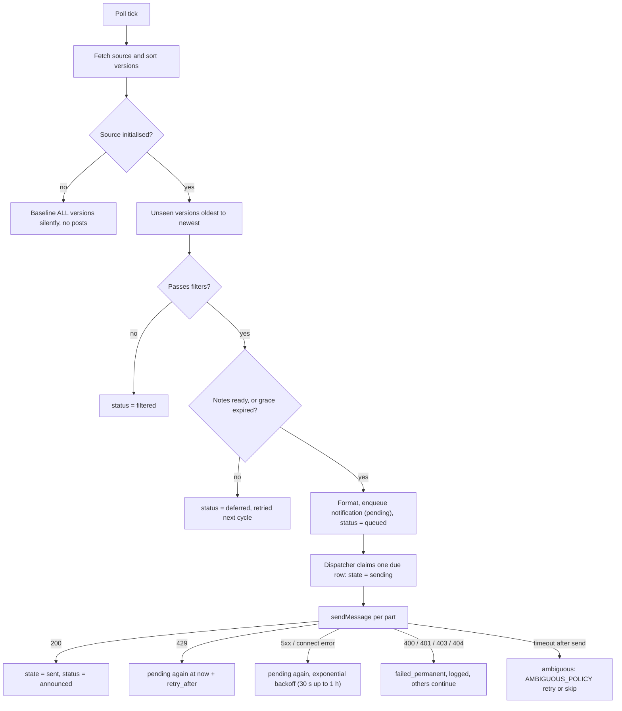

# Architecture

This document describes how the monitor is put together and why. It reflects the code in
`src/release_monitor/`; when the two disagree, the code wins and this file has a bug.

## Components

| Module | Responsibility |
|---|---|
| `config.py` | Reads environment variables into a frozen `Config`, reports **all** problems at once, hides the token from `repr`. |
| `logging_config.py` | UTC timestamps, text or JSON, a redaction filter for the token, quiets the `httpx` loggers (they log request URLs, and Telegram puts the token in the URL). |
| `http.py` | One shared `httpx.Client`, retries with exponential backoff and jitter for network errors, 5xx and 429 (honouring `Retry-After`), errors that never contain a token URL. |
| `sources/minecraft.py` | Parses the manifest, classifies versions (stable, snapshot, pre-release, release candidate), reads highlights from the patch-notes feed, confirms an article URL exists before linking it. |
| `sources/neoforge.py` | Parses and **sorts** Maven versions, classifies stable/beta/alpha, derives and verifies the Minecraft version, extracts one build's changelog entry, reads the artifact timestamp. |
| `storage/` | Connection setup, schema v2 and migrations, single-instance lock, the repository (all SQL lives here). |
| `notifier/formatting.py` | Builds HTML messages from structured blocks and splits them safely. |
| `notifier/telegram.py` | `sendMessage` / `getMe`, error classification. |
| `dispatcher.py` | Delivers outbox rows: pacing, retries, backoff, recovery. |
| `app.py` | One poll cycle: fetch, baseline or detect, queue, deliver. |
| `health.py` | Heartbeat file and the offline health check. |
| `cli.py` | Commands, exit codes, signal handling, startup order. |

## Detection and delivery flow

Key rules:

- **The first run only records.** `baseline()` stores *every* version the source lists, regardless of your
  filters, in one transaction. Later, a version already in the database is never "new", so switching
  `MINECRAFT_SNAPSHOTS`, `NEOFORGE_BETAS` or `NEOFORGE_MIN_MAJOR` can never flood the channel. An empty or
  failed fetch never initialises a source.
- **Failures are isolated per source.** An outage of Mojang does not block NeoForge or the delivery of
  pending messages. `meta` keeps a `last_success:<source>` stamp per source for the health check.
- **Ordering.** Releases of one source are queued oldest to newest. If an older release is still waiting
  for its notes (inside the grace window) newer ones wait behind it so announcements stay in order.
- **Late notes.** `CHANGELOG_GRACE_MINUTES` (default 30) is measured from `first_seen_at`, the first poll that
  saw the release. When it expires the message says the notes are not available yet and still links the
  official page. Nothing is ever invented.
- **Pacing.** At least 1.1 s between messages to the same chat.
- **Multi-part messages.** A long message is split on line boundaries into parts of at most 3900 characters
  (Telegram's limit is 4096). The outbox payload records how many parts were acknowledged, so a retry
  resumes after the last acknowledged part instead of repeating them. Text is truncated *before* escaping,
  and rendered HTML is never sliced, which avoids the "broken tag, HTTP 400, retry forever" failure.

### Delivery guarantee

Delivery is **at-least-once with minimised duplicate risk**, not exactly-once:

1. The row moves to `sending` and is committed *before* the HTTP call (write-ahead intent).
2. The acknowledgement (`sent`, with the Telegram message id) is committed *immediately* after HTTP 200.
3. A single-instance lock guarantees one process sends at a time, and sends are sequential.

The remaining window is a crash or lost response between 1 and 2. On the next start, `recover_on_start()` finds
rows still in `sending`: with `AMBIGUOUS_POLICY=retry` they go back to `pending` (logged as an ambiguous retry,
possible duplicate), with `skip` they become `failed_permanent` with error class `ambiguous_skipped`
(possible miss). Telegram has no idempotency key and a bot cannot read channel history, so the monitor cannot
settle this itself. Timeouts *after the request was sent* are treated the same way and are not auto-retried
inside the client; a connection error *before* sending is a safe transient failure.

## SQLite schema (version 2)

| Table | Purpose |
|---|---|
| `releases` | One row per `(source, version)`: `kind`, `published_at` + `published_at_kind` (`official`, `artifact`, `detected`), verified `mc_version`, `url`, `status` (`baselined`, `filtered`, `deferred`, `queued`, `announced`), `first_seen_at`, `discovered_at`. |
| `notifications` | The outbox: one row per `(source, version)` (UNIQUE), `state` (`pending`, `sending`, `sent`, `failed_permanent`), JSON `payload` (message parts + progress), `attempts`, `attempt_id`, `next_attempt_at`, `last_error_class`, `telegram_message_id`, `origin` (`live`, `backfill`, `legacy`), timestamps. Indexed on `(state, next_attempt_at)`. |
| `initialized` | Which sources have been baselined. |
| `meta` | Key/value, for example `last_success:minecraft`. |

All timestamps are UTC ISO-8601 strings. `PRAGMA user_version` holds the schema version.

### Migrations

Migrations are an ordered list of SQL steps driven by `PRAGMA user_version`; there is no migration framework.

- **Fresh database** (version 0, no tables): created directly at version 2.
- **Legacy v1 database** (the old `monitor.py` tables `sent` and `initialized`): first copied once to
  `<db>.bak-v1` (never overwritten), then migrated in one transaction. Every legacy `sent` row becomes a
  `releases` row plus a `sent` notification with origin `legacy`, so nothing already announced can be announced
  again. The legacy `sent` table is left in place.
- **Newer than known:** refused with a clear error and never modified.

### Concurrency, durability and corruption

- Default rollback journal with `synchronous=FULL`, **not** WAL: WAL does not work on network file systems
  (NFS, SMB) which NAS users often bind-mount, and this workload writes a few rows per hour.
- `busy_timeout` plus explicit `BEGIN IMMEDIATE` transactions; foreign keys on.
- **Single-instance lock** `<db dir>/.lock` (`fcntl.flock` on POSIX, `msvcrt.locking` on Windows). A second
  process exits with code 3. Locks are only reliable on local file systems.
- `PRAGMA integrity_check` runs at start-up. A damaged or non-database file raises a clear error (exit code 4)
  and is never deleted.
- `db-backup` uses `VACUUM INTO`, a consistent copy that works while the service runs.

## Why synchronous `httpx` instead of `asyncio`

The workload is two small polls every five minutes and a handful of Telegram messages. Sequential sends make
Telegram's rate limits trivial to respect (about one message per second per chat), and a single-threaded loop
keeps SQLite transactions simple and the shutdown logic obvious (`threading.Event.wait(interval)` instead of
`sleep`). Async would add complexity and no throughput benefit. `httpx` was chosen over `urllib` for clean
timeouts, connection reuse and `MockTransport`, which lets the whole pipeline be tested without any network.
The cost is one dependency, pinned in `uv.lock` and audited in CI.

## Error handling

| Situation | Behaviour |
|---|---|
| Source unreachable, malformed or empty | Logged for that source, nothing initialised or queued, the other source continues, `last_success` not updated. |
| Notes or changelog missing | Release stays `deferred` until ready or the grace period ends. |
| Telegram 429 | Row rescheduled at `now + retry_after`. |
| Telegram 5xx / connection refused | Row rescheduled with exponential backoff (30 s doubling, capped at 1 h). |
| Telegram 400/401/403/404 | `failed_permanent`, logged with a hint (chat id, admin rights, token), other messages continue. |
| Timeout after the request was sent | Ambiguous: handled by `AMBIGUOUS_POLICY`. |
| Unexpected exception in a cycle | Logged (with redaction); the loop continues with the next cycle. |
| `SIGTERM` / `SIGINT` | The current step finishes, connections close, the lock is released; exit code 0. |
| Invalid configuration | Exit 2 with every problem listed and no secret printed. |

## Health check

The loop writes `<db dir>/heartbeat` (atomically, UTC timestamp) after each cycle. `healthcheck` reports
unhealthy when the heartbeat is missing or older than `3 × POLL_SECONDS + 60 s`, when the database cannot be
opened read-only, or when no source has polled successfully in the last `6 × POLL_SECONDS`. It uses local
state only (no network), so a Telegram or upstream outage does not by itself kill the container, and it prints
no configuration.
